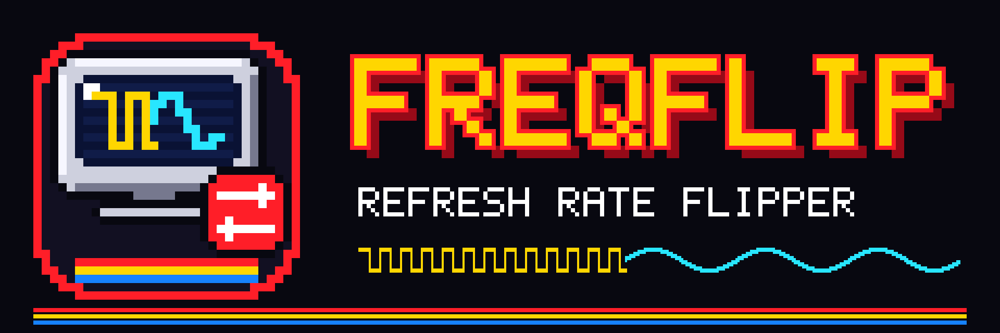
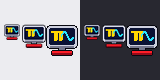
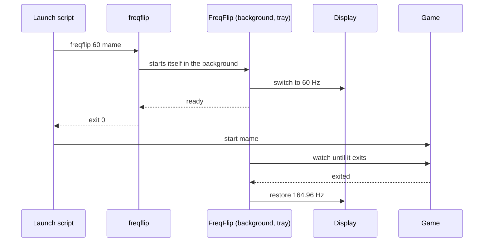

<div align="center">



### Flip your display to the game's refresh rate, and back when you're done.

**A tiny tray tool that switches your monitor to 60 Hz (or 50, or 59.94, or 120, optionally at another resolution) for one game, waits for it to quit, and puts your original mode back.**

[](https://github.com/tbreckle/freqflip/actions/workflows/ci.yml)
[](https://github.com/tbreckle/freqflip/releases)
[](LICENSE)


[**Download**](https://github.com/tbreckle/freqflip/releases) ·
[Why?](#-why) ·
[Quick start](#-quick-start) ·
[Usage](#%EF%B8%8F-usage) ·
[Frontends](#-hook-it-into-your-frontend) ·
[Platforms](#%EF%B8%8F-platform-support) ·
[Building](#-building-from-source)

</div>

---

## 🎯 Why?

Your desktop runs at 144 or 165 Hz. Your arcade game was made for 60 Hz, or 57.5, or 50. Light guns, CRT emulation shaders, and frame pacing all work best when the display runs at the game's own rate, but you don't want to switch it by hand every time, and you definitely don't want to forget to switch it back.

**FreqFlip does the flip for you:**

```bash
freqflip 60 mame
```

1. 🔀 Switches the primary display to **60 Hz**, keeping its resolution
2. ↩️ Returns **right away**, so your launch script goes on to start the game
3. 👀 Sits in the **tray** and waits for `mame` to start and then to exit
4. ✅ Flips back to your **original rate**

Need another resolution as well? `freqflip 640x480@60 mame`.

## ✨ Features

<table>
<tr>
<td width="50%" valign="top">

#### 🔀 Flipping
- **Any rate the display offers**: 50, 59.94, 60, 120 Hz, ... matched within a tolerance
- **Resolution too, if you want**: `640x480@60`, or just `1920x1080`; otherwise it stays put
- **Any display**: the primary one by default, or pick one with `--display`
- **Always restores**: on process exit, from the tray menu, on Ctrl+C / SIGTERM, and when the game never shows up

</td>
<td width="50%" valign="top">

#### 👀 Watching
- **By name** (`mame`, `mame.exe`, `/usr/bin/mame`) or **by PID**
- **Starts before the game**: waits up to `--start-timeout` for it to appear
- **Launcher-proof**: a short grace period survives games that restart themselves
- **Background by default**, with a proper exit code and error messages for your scripts

</td>
</tr>
<tr>
<td width="50%" valign="top">

#### 🖥️ Tray icon
- **Tooltip and menu** show the target, original and current rate (and resolution), plus the watched process
- **"Restore and exit"** gives you the original rate back early
- **`--no-tray`** for headless setups

</td>
<td width="50%" valign="top">

#### 🧰 Everywhere
- **Windows**, **macOS** (Apple Silicon + Intel) and **Linux** (X11, GNOME, KDE, wlroots)
- **One small binary**, no runtime dependencies on Linux either
- **`--log`** file for when a frontend starts it out of sight

</td>
</tr>
</table>

<div align="center">
<br/>
<sub>The tray icon at 16, 24 and 32 px on light and dark panels</sub>
</div>

## 🚀 Quick start

1. **Grab the latest release** from the [Releases page](https://github.com/tbreckle/freqflip/releases):

   | File | Platform |
   |---|---|
   | `freqflip-X.Y.Z-linux-x86_64.tar.gz` | Linux |
   | `freqflip-X.Y.Z-windows-x86_64.zip` | Windows |
   | `freqflip-X.Y.Z-macos-universal.tar.gz` | macOS (Apple Silicon + Intel) |

2. **See what your display can do:**

   ```console
   $ freqflip --list
   Backend: X11 (XRandR)

   * DisplayPort-2 [primary]
       current:   2560x1440 @ 164.96 Hz
       available: 2560x1440   164.96 Hz, 143.97 Hz, 120 Hz, 99.95 Hz, 59.95 Hz
                  1920x1080   120 Hz, 119.88 Hz, 100 Hz, 60 Hz, 59.94 Hz, 50 Hz
                  640x480     60 Hz, 59.94 Hz
   ```

3. **Flip it:**

   ```console
   $ freqflip 60 mame
   DisplayPort-2: 164.96 Hz -> 59.95 Hz, restoring when mame exits
   ```

   Or with another resolution:

   ```console
   $ freqflip 640x480@60 mame
   DisplayPort-2: 2560x1440 @ 164.96 Hz -> 640x480 @ 60 Hz, restoring when mame exits
   ```

> [!TIP]
> `59.95` was picked for `60` because it's within the default tolerance of 0.5 Hz. Use `--tolerance` to be stricter or looser.

## ⌨️ Usage

```
freqflip [OPTIONS] <MODE> <PROCESS>
freqflip --list
```

| Argument / option | Meaning |
|---|---|
| `MODE` | Target refresh rate (`60`, `59.94`), resolution (`1920x1080`, `640x480i` for interlaced) or both (`640x480@60`) |
| `PROCESS` | Process to wait for: a name (`mame`, `mame.exe`) or a PID |
| `-d, --display <ID>` | Display to switch, as shown by `--list` (default: primary) |
| `-t, --tolerance <HZ>` | Maximum distance between requested and chosen rate (default: `0.5`) |
| `-s, --start-timeout <S>` | How long a named process may take to start (default: `60`, `0` = forever) |
| `-f, --foreground` | Don't return early, stay in the foreground until the rate is restored |
| `--no-tray` | No tray icon |
| `--log <FILE>` | Append progress messages to a file |
| `--save` | Windows only: save the mode like the Settings app does, for emulators that reset the display to its saved mode at startup (see below) |
| `-b, --backend <NAME>` | Linux only: `auto`, `x11`, `gnome`, `kde`, `wlr` |
| `-l, --list` | List displays with their resolutions and refresh rates |

**Modes:** without a resolution, the current one is kept and only the refresh rate changes. Without a rate, FreqFlip picks the one closest to the current rate at the new resolution. Color depth (Windows) and HiDPI scaling (macOS) are kept when the new resolution offers them.

**Exit code:** `0` once the mode is switched (or already was right), `1` if it couldn't be switched. Errors are printed to stderr, so a script can bail out before starting the game.

**`--save` (Windows):** FreqFlip's switch is temporary, Windows keeps your normal mode saved. Some emulators reset the display to that saved mode when they start, which undoes the switch (switching in the Settings app works because it saves the mode). `--save` saves the switched mode too and saves your normal mode back on restore. If FreqFlip is killed (`taskkill /F`) or Windows crashes before that, the switched mode stays saved until you change it back.

**Names** are matched case-insensitively, with or without `.exe`, against the process name, its executable and its first argument. FreqFlip waits until **no** process with that name is left.

## 🎮 Hook it into your frontend

Start FreqFlip right **before** the game. It returns as soon as the rate is switched and then waits for the game in the background.

**Windows batch file** (LaunchBox, RetroBat, Hook Of The Reaper, ...):

```bat
@echo off
freqflip.exe 60 mame.exe || exit /b 1
mame.exe %*
```

**Linux / macOS shell script:**

```bash
#!/bin/sh
freqflip 60 mame || exit 1
exec mame "$@"
```

**By PID**, if the game is already running:

```bash
mame tcrisis &
freqflip 60 $!
```

## 🧩 How it works



The foreground call only returns after the background copy reports back, so errors (unknown display, unsupported rate, missing PID) reach your script with exit code `1`.

## 🖥️ Platform support

| Platform | How the mode is switched | Tray |
|---|---|---|
| **Windows** 10/11 | `SetDisplayConfig`, checked against the real signal timing (not saved: a reboot always brings back your normal mode; `--save` saves it for emulators that would reset it) | Notification area |
| **macOS** 11+ | Quartz Display Services, "for app only": macOS itself restores the mode when FreqFlip exits | Menu bar |
| **Linux, X11** | XRandR; a new resolution resizes the screen like `xrandr` does | StatusNotifierItem |
| **Linux, GNOME** (Wayland/X11) | Mutter D-Bus API, temporary config (never written to `monitors.xml`); monitors right of or below a resized one move along | StatusNotifierItem¹ |
| **Linux, KDE Plasma** (Wayland) | `kscreen-doctor` | StatusNotifierItem |
| **Linux, wlroots** (Sway, Hyprland, labwc, ...) | `wlr-randr` | StatusNotifierItem² |

¹ Stock GNOME needs the *AppIndicator and KStatusNotifierItem Support* extension for tray icons (Ubuntu ships it). Without a tray, FreqFlip still works; use `--no-tray` to skip it.
² Needs a bar with a tray, e.g. Waybar's `tray` module.

On Linux, `--backend auto` picks X11 for X sessions, and GNOME, KDE or wlroots on Wayland from `XDG_CURRENT_DESKTOP`.

> [!NOTE]
> **macOS:** the release binary isn't signed. If Gatekeeper blocks it, run `xattr -d com.apple.quarantine freqflip` once.
>
> **Windows:** `freqflip.exe` is a GUI app, so frontends can start it without a console window flashing up. In a terminal it still prints its messages.

## 🔧 Building from source

**Requirements:** Rust 1.90+ (the pinned toolchain in `rust-toolchain.toml` is installed automatically by rustup). No system libraries are needed on Linux.

```bash
cargo build --release   # target/release/freqflip
cargo test              # unit tests
cargo clippy            # lint (warnings fail CI)
cargo fmt --check       # formatting check
FREQFLIP_VERSION=$(scripts/version.sh) cargo build --release   # with the version CI would inject
```

The icons and logo are pixel art drawn by `images/generate.py` (needs Pillow): `python3 images/generate.py`.

<details>
<summary><b>🗂️ Repository layout</b></summary>

```
freqflip/
├── Cargo.toml             # The crate
├── build.rs               # Version injection, Windows icon
├── src/
│   ├── main.rs            # Entry point
│   ├── cli.rs             # Command line (clap)
│   ├── app.rs             # Switch, wait, restore
│   ├── display.rs         # Display model, mode selection
│   ├── process.rs         # Finds and watches the process
│   ├── report.rs          # Background start, messages, log
│   ├── event_loop.rs      # Main-thread loop for the tray
│   ├── tray.rs            # Tray icon, tooltip and menu
│   └── backend/           # windows, macos, x11, gnome, kde, wlr
├── images/                # Logo, icons, generate.py
├── scripts/               # version.sh, changelog.sh, test.sh
└── .github/workflows/     # CI, release-start, release-finish
```

</details>

## 🤝 Contributing

Contributions are welcome! The project uses **GitFlow**: branch `feature/*` off `develop` and open a PR back to `develop`. CI builds and tests on Linux, Windows and macOS for every push.

- 📖 [GITFLOW.md](GITFLOW.md): branching, versioning and releases
- ⚙️ [.github/WORKFLOWS.md](.github/WORKFLOWS.md): the CI/CD pipelines
- 📝 [CHANGELOG.md](CHANGELOG.md): add your change under `## [Unreleased]`

## 📜 License

FreqFlip is released under the [MIT License](LICENSE).

---

<div align="center">

**🪙 INSERT COIN TO CONTINUE 🪙**

<sub>Made with 🔥 for light gun fans. A sibling of <a href="https://github.com/tbreckle/blast">B.L.A.S.T.</a></sub>

</div>

---

## ⚖️ Legal Disclaimer

**USE AT YOUR OWN RISK**

This software is provided "AS IS" without warranty of any kind, express or implied, including but not limited to the warranties of merchantability, fitness for a particular purpose, and non-infringement.

- The developers and contributors of this project assume **no liability** for any damages, losses, or issues arising from the use, misuse, or inability to use this software
- This includes, but is not limited to: hardware damage, data loss, system malfunction, or any other direct or indirect consequences
- Only switch to modes your display reports as supported; FreqFlip only offers those, but you are responsible for your hardware
- By using this software, you acknowledge that you do so at your own risk
- This project is an independent effort and is not affiliated with or endorsed by any hardware or software manufacturer
